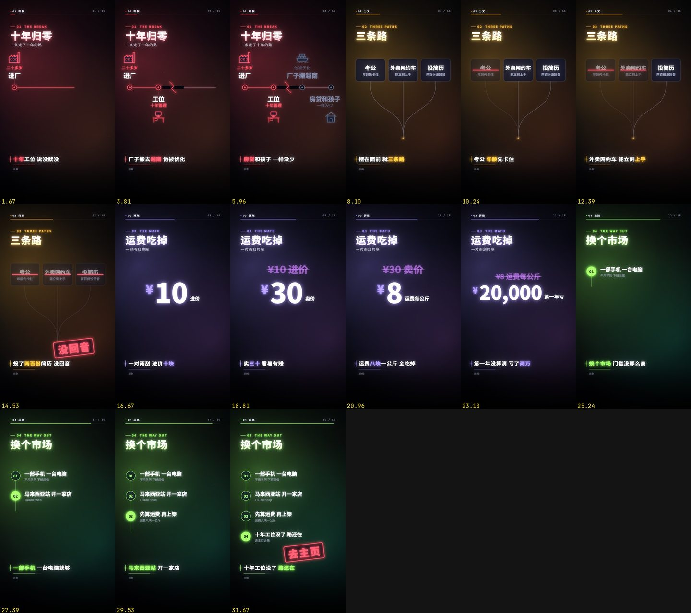

# leadgen-knowledge-film

做**引流用的竖屏卡点知识短片**的 AI 技能（Claude Code / DeepSeek 等支持 skill 的 AI 助手都能用）：
1080×1920、30 / 60 / 90 秒、没有旁白，一句粗字幕正好一小节，画面每一次变化都落在音乐重拍上。



> 上图是用 DeepSeek（deepseek-flash）按本技能写出的 32 秒示例《被裁之后》。片里的数字都是**示例**，不是真实数据。

## 它怎么做到"便宜模型也能稳定出片"

AI 不写画面代码，只写一份 `film.json`：字幕，加上每一镜用哪个画面件、填什么字。
画面由技能自带的 15 个霓虹风格画面件和 28 个线条图标来画：片名卡、一句话、大数字、横条、环形占比、人生节点、岔路、对比、打勾清单、步骤、飞轮、卡片墙、一样东西（或一堆）、从 A 到 B、算账；图标有手机、简历、工位、床、工厂、包裹、轮船、地球等。
所以排版错、字压字、出画这类毛病由画面件管住，和用哪个模型无关。

写法是**画面先行**（照标杆样片和上游项目总结出来的）：一章先定一个大关键词和一个画面，再让 2–5 句字幕跟着画面一条条长出来，
所以一个画面撑三四句、每句都往上加一样东西，不会一句换一页像幻灯片。

出片前 `check_film.py` 会拦下这些问题：字幕带标点或太长、数字没写出处或编出来的、字幕说了数画面上却没有、一句换一个画面、全片都是文字清单、出现联系方式、出现收入承诺（月入、回本、零成本…）、写给自己看的话上屏、相邻两章同色。
实测 DeepSeek 一般改一两轮就能通过。

## 流程

1. **先问需求**（7 个问题）：给谁看、他的处境、你有什么证据、看完让他做什么、时长、不能出现的说法、把人引到哪个方向。没问清楚不开工。
2. **定结构**：推荐的引流骨架是"人生节点 → 断裂 → 分叉 → 收窄 → 出路 → 行动"。出路默认是跨境电商，可以换；结构也可以和用户商量着改。
3. **写 film.json**：画面先行——每章按 `key`（大关键词）→ `pics`（每句画面上多出什么）→ `shot`（这章的画面）→ `lines`（字幕）的顺序写，一句一小节。
4. **配乐**：默认按片子结构自动作曲（律动 / 紧张 / 温暖 / 轻松四种风格，没有版权问题）；有能商用的歌就用 `fit_song.py` 量节拍、挑段落、把片子卡到歌的重拍上（给一个文件夹就逐首分析、挑最合适的）；想用平台热歌，出片时会多出一版只有卡点音效的，在 App 里加歌。
5. **出片**：`bash scripts/build.sh <工程>` 依次做检查、配乐、渲染画面、混音到 −14 LUFS，并在文件里写入 AI 生成标记，最后出一张自查拼图。

## 安装

主要适配 **DeepSeek Harness**，Claude Code、Codex 等支持 skill 的助手也能用：

```bash
# DeepSeek Harness
git clone https://github.com/zhubing20011218-hub/leadgen-knowledge-film ~/.dsh/skills/leadgen-knowledge-film
# Claude Code（其他助手放进它自己的 skills 目录）
git clone https://github.com/zhubing20011218-hub/leadgen-knowledge-film ~/.claude/skills/leadgen-knowledge-film

bash ~/.dsh/skills/leadgen-knowledge-film/scripts/setup.sh      # 建 .venv、装 playwright + pillow、下载开源字体（约 40MB）
```

还需要 node 和 ffmpeg。然后在助手里说"做一条引流的知识短片"，它会先问你需求；
助手能看图（DeepSeek Harness 的 `read_image`、Claude 的 `Read`）就自己看拼图改，不额外花钱。

## 不开助手，直接用 DeepSeek 接口全自动

```bash
S=~/.dsh/skills/leadgen-knowledge-film
echo "DEEPSEEK_API_KEY=你的钥匙" > $S/.env && chmod 600 $S/.env     # .env 不会进 git
mkdir -p ~/Desktop/知识短片/film-demo && cp $S/examples/01-被裁之后/brief.json ~/Desktop/知识短片/film-demo/
python3 $S/scripts/ds_make.py ~/Desktop/知识短片/film-demo            # 写 → 检查 → 看图评审 → 改；加 --render 连整片一起出
```

实测（deepseek-flash，空闲时段）：30 秒一条约 ¥0.03–0.05，60 秒约 ¥0.05–0.08（个别错改不掉时会换 pro 改一轮，多 ¥0.06 左右）；工作日白天高峰翻倍。每条默认最多花 ¥0.5，账在 `review/cost.json`。

## 目录

| | |
|---|---|
| `SKILL.md` | 给 AI 读的流程和红线 |
| `references/` | 需求访谈、叙事骨架、film.json 格式、15 个画面件和图标、配乐与卡点、检查表、合规红线 |
| `template/` | 画面模板（播放器 + 15 个画面件 + 28 个图标 + 章节色） |
| `engine/` | 逐帧渲染引擎 |
| `scripts/` | 建工程、一键出片、检查、按片子结构生成配乐 |
| `examples/` | 示例需求和 film.json |

## 红线

不编数字（编的一律标「示例」，示例片不发布）、不承诺收入、不贩卖焦虑（讲了焦虑就要给出口）、不放联系方式、发布时打开平台的"AI 生成内容"声明。

## 授权

本仓库代码 MIT。渲染引擎来自 [HeyChengC/vibe-knowledge-film](https://github.com/HeyChengC/vibe-knowledge-film)（MIT），
配乐合成器来自 [8533502-dev/deepseek-opus-motion-skill](https://github.com/8533502-dev/deepseek-opus-motion-skill)（MIT），
字体为 SIL OFL 1.1，详见 `LICENSE-THIRD-PARTY.md`。
仓库里不含任何第三方音乐。和抖音上的任何账号都没有关系。
